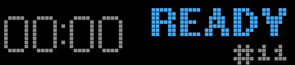
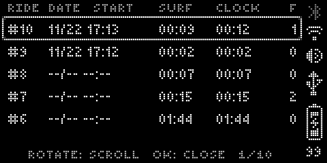
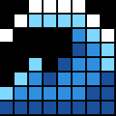
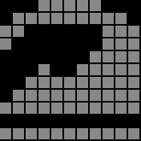

# Wakesurf Timer for BUSY Bar

A ride timer for boat captains. Made for wakesurfing; works the same for wakeboarding and waterskiing.

The captain starts the clock when the rider is up and pauses it when the rider falls.
When the ride is over, one button press saves it. The bar keeps the **last 20 rides**, each with:

| Field | Meaning |
|---|---|
| **Ride #** | Running ride number (keeps counting across sessions) |
| **Date / Start** | Month/day and hour:minute when the ride started, e.g. `11/22 17:13` |
| **Surf time** | Time the rider was actually surfing. Pauses are **not** counted |
| **Clock time** | Wall time from start to end of the ride. Pauses **are** counted |
| **Falls** | How often the ride was paused and resumed |

The difference between clock time and surf time is the time spent picking the rider up after falls.

---
## Required Hardware: 
https://busy.app/

## User manual

### Buttons

| Button | Where on the bar |
|---|---|
| **START** | Big button on top |
| **OK** | Pressing the wheel |
| **Wheel** | Turning the wheel |
| **BACK** | Back button |

### A typical session

1. **Open the app** from the bar's app menu: look for the blue wave and *Wakesurf Timer*.

   


   The front shows `Wakesurf / PRESS START`.
2. **Press START** to begin the session. The display shows `READY` and the number of the next ride.
3. **Rider is up: press START.** The clock runs, the front shows **SURF** in green.
4. **Rider falls: press START.** The clock stops, the front shows **PAUSE** in yellow, the fall counter goes up (`F1`, `F2`, …).
5. **Rider is back up: press START** again to continue the same ride.
6. **Ride is over: hold START** (about a second). The ride is saved and the clock goes back to `READY` for the next rider.
   The usual way is: rider falls → press START (pause) → if the ride is over, hold START.
   If you finish while paused, that last pause is counted as the end of the ride, not as a fall,
   and the clock time ends at the moment you paused.
7. Repeat 3–6 for every rider.
8. **End the session:** press **BACK** while `READY`.
9. **Leave the app:** press **BACK** on the start screen.

You never need OK. It still works as a second way to finish a ride (press) or end the session (hold),
but see *Troubleshooting* if the bar is connected to Home Assistant.

### All buttons by screen

| Screen | START | Hold START | BACK | Wheel | OK (optional) |
|---|---|---|---|---|---|
| Start screen | start session | – | quit app | open history | open history |
| READY | start ride | – | end session | open history | open history; hold: end session |
| SURF (riding) | pause (fall) | **finish & save ride** | *ignored* | *ignored* | finish & save ride |
| PAUSE | resume | **finish & save ride** | *ignored* | *ignored* | finish & save ride |
| History | close history, start ride | – | close history | scroll | close history |

BACK and the wheel do nothing while a ride is running, so the clock can't be lost by a stray press.
Rides shorter than 2 seconds are ignored (accidental double press).
Holding BACK always force-quits the app (built into the bar); a running ride is then lost.

### What the displays show

**Front (72×16, colour)**: surf time on the left; state, ride number and falls on the right.

| State | Front display |
|---|---|
| **READY**: waiting for the next rider (grey clock at 00:00, ride #11 next) |  |
| **SURF**: rider is up, clock running (green) |  |
| **PAUSE**: rider fell, clock stopped (yellow), `F1` = 1 fall |  |

**Back (greyscale)**

- top: ride number and how long the session has been running
- middle: large surf time, state, `CLOCK mm:ss  FALLS n`
- below: button hints
- bottom: surf times of the last 4 rides

### History

Turn the wheel on the start screen or on `READY` to open the history.

- **Front:** bottom row: surf time (cyan, left) and clock time (blue, right).
  Top row: alternates every 2 s between `RIDE #10` and the start date/time `11/22 17:13`.
  All text uses the 7-dot font so it stays readable from the helm.
- **Back:** table of 5 rides around the selection: `RIDE  DATE START  SURF  CLOCK  F`.
  The selected ride has a frame; `3/20` at the bottom shows the position.



*Ride #10 started on 11/22 at 17:13: 9 s surfing, 12 s on the clock, 1 fall.
Rides #8 and older were recorded with version 1.0, so they have no date.
The icons on the right edge belong to the bar itself.*

Turn the wheel to scroll, press BACK to close.
Rides recorded with version 1.0 have no date and show `--/-- --:--`.

### Status light

The LED blinks once on each state change: blue = ready, green = ride started or resumed,
yellow = paused, red = session ended.

### Date and time

The start time comes from the bar's own clock (synced over Wi-Fi, time zone set in the BUSY app).
If the bar's clock is wrong, the ride times are still right but the date/start is off.

---

## Troubleshooting

**Pressing OK shows a house / "Home Assistant" screen.**
That screen comes from the *BUSY Bar* integration in Home Assistant, not from this app.
It reacts to the bar's OK button and draws its dashboard with display priority 100, covering the timer.
The timer keeps running underneath and the ride is still saved. Press BACK to close that screen.
That's why the app uses **hold START** to finish a ride: you never need to press OK.
It only happens while the bar can reach Home Assistant (home Wi-Fi), so not on the boat.
While that screen is open, the wheel controls the Home Assistant accessory shown on it.

**Reading the bar's log** (over USB):

```powershell
Invoke-RestMethod -Method Post "http://10.0.4.20/api/log_dump?filename=log"
```

Then download `/ext/log.txt` with `storage/read` (same as the history file below).

## Install / update

The easiest way is the BUSY app catalog. To install from source instead:

App installs only work over **USB**: over Wi-Fi the bar refuses them (403 Forbidden).

1. Install [Node.js](https://nodejs.org) 24 or newer.
2. Connect the BUSY Bar to the PC with a USB-C cable (it is then reachable at `10.0.4.20`).
3. In this folder run:

```powershell
.\deploy.ps1
```

This builds `src\` with `busy-cli` into `dist\io.github.superwolfi82.wakesurf.tgz`, installs it and starts it.
Your ride history is kept when you update.
(Versions before 1.4.0 used the app ID `app.wakesurf.timer`; their history stays with that old app.)

Without PowerShell, `npm ci` then `npm run build` and `npm run app:install` do the same.

Other options:

```powershell
.\deploy.ps1 -PackageOnly
```

```powershell
.\deploy.ps1 -Launch
```

```powershell
.\deploy.ps1 -Quit
```

After installing, the app also appears in the bar's app menu, so a PC is not needed on the boat.

## Where the history is stored

On the bar, in `/ext/apps_data/js_apps/io.github.superwolfi82.wakesurf/wakesurf_timer_history.json`
(inside the app the path is `/ext/data/wakesurf_timer_history.json`). Example entry:

```json
{"n":10,"d":"11/22 17:13","t":9126,"c":12649,"f":1}
```

`t` = surf time in ms, `c` = clock time in ms, `f` = falls. To read it over USB:

```powershell
Invoke-WebRequest "http://10.0.4.20/api/storage/read?path=/ext/apps_data/js_apps/io.github.superwolfi82.wakesurf/wakesurf_timer_history.json" -UseBasicParsing | Select-Object -ExpandProperty Content
```

## App icon

A breaking wave, drawn pixel by pixel:

| Front (8×8, colour) | Back (11×11, grey) |
|---|---|
|  |  |

The pixel maps live in [tools/make-icons.ps1](tools/make-icons.ps1). To change the icon, edit the maps there, then run these two commands and reinstall:

```powershell
.\tools\make-icons.ps1
```

```powershell
.\deploy.ps1
```

## Project files

```
src/
  appmeta/manifest.json         app id, name, version (1.4.0)
  appmeta/icon_front_8x8.png    app icon, front display / app menu
  appmeta/icon_back_11x11.png   app icon, back display
  main.js                       the whole app (plain JavaScript, runs on the bar's JerryScript engine)
package.json, package-lock.json build tool (@busy-app/cli)
deploy.ps1                      build + install + launch over USB
tools/make-icons.ps1            generates the two icon PNGs from pixel maps
dist/                           built package (created by the build, not committed)
screenshots/                    72x16 / 160x80 screenshots for the app catalog
docs/screenshots/               enlarged display screenshots used in this README (taken from the bar)
```

The app only uses the bar's local HTTP API: `display/draw`, `storage/read|write`, `time`.
